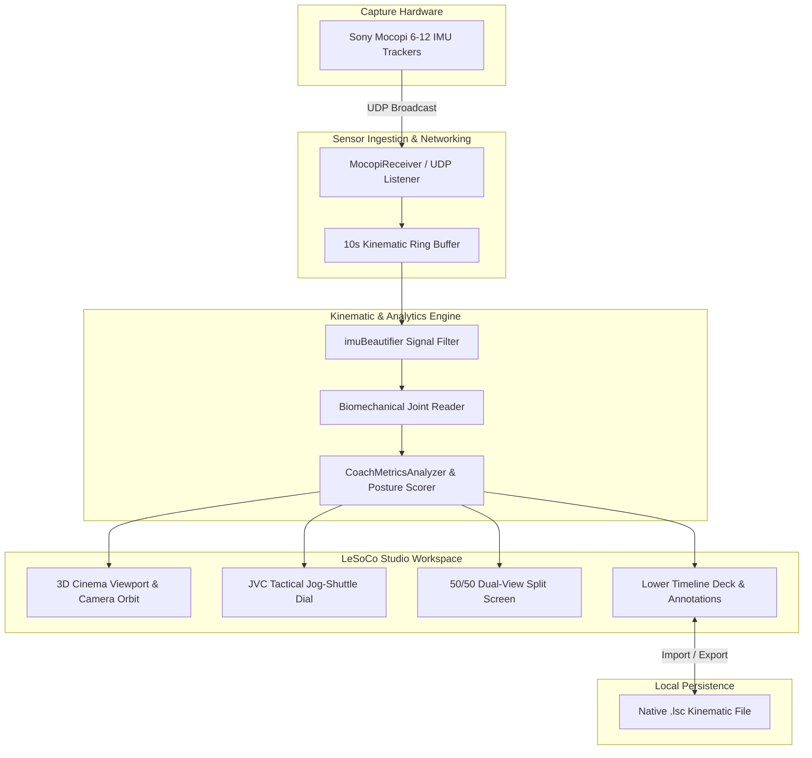

# LeSoCo (Lenovo Soccer Coach)

<div align="center">


-orange.svg?style=flat-square)


**A high-precision 3D kinematic visualization, biomechanical analytics, and tactical coaching suite.**

[Web Portal](https://sniffuntidypond.github.io/LeSoCo/) • [Living Roadmap](https://monogr.ph/s/4Dr8yxLzxa) • [Repository](https://github.com/sniffuntidypond/LeSoCo.git)

</div>

---

## 📖 What is LeSoCo?

**LeSoCo** (**Le**novo **So**ccer **Co**ach) is an advanced 3D motion-capture visualization, kinematics inspection, and digital human coaching platform developed in **Unity (URP)**. Born out of the broader **BodyCTRL** motion analysis platform (originating with stroke rehabilitation and musculoskeletal [MSK] injury prevention) and engineered for the **Lenovo × Fandi** initiative, LeSoCo provides sports scientists, coaches, and athletes with broadcast-grade kinematic playback, real-time posture analysis, and tactile motion scrubbing.

Traditional optical motion capture setups require costly studio infrastructure, multiple synchronized high-speed cameras, and lengthy calibration. LeSoCo eliminates these barriers by running on lightweight, camera-free wearable inertial measurement units (**Sony Mocopi** 6-to-12 IMU sensor rigs). It translates real-time sensor telemetry into sub-degree-accurate joint kinematics, frame-accurate motion trimming, and automated biomechanical evaluations.

---

## 🌟 Key Features

### 1. 🎛️ 4K Studio Workspace & Motion Editor
- **DaVinci Resolve-Inspired Ergonomics**: Professional dark-themed inspection interface (`ModernUITheme`) featuring Media Pool, 3D Cinema Monitor, Lower Timeline Deck, and Inspector.
- **Non-Destructive Trimming**: Set frame-accurate in/out boundary markers (`[I]` / `[O]`) to isolate critical athletic phases (e.g., wind-up, impact, follow-through) without altering raw capture data.
- **Multi-Speed Transport**: Instant playback scaling across `0.25x`, `0.5x`, `1.0x` (real-time 60 FPS), and `2.0x`.
- **Dynamic Posture Filmstrip**: Generates visual 3D thumbnail keyframes along the timeline track for fast spatial orientation.

### 2. 🎮 Recording Dashboard & JVC Jog-Shuttle
- **Dual-Track Role Architecture**: Dedicated separation between **Coach Benchmark Tracks** (master reference movements) and **Trainee Trial Tracks** (live attempts).
- **Virtual JVC Jog-Shuttle Dial**: Hardware-inspired scrubbing wheel supporting deceleration/acceleration from `-5.0x` high-velocity reverse to `+5.0x` fast-forward, with single-frame micro-stepping and a zero-latency center detent.

### 3. 📐 Biomechanical Analytics Engine
- **Sub-Degree Joint Angle Tracking**: Real-time angular comparison (calculated to `0.1°` precision) between student execution and coach benchmarks across shoulders, elbows, hips, knees, and ankles.
- **Automated Posture Evaluation**: Contextual feedback system that highlights kinetic chain misalignment, hip drop, or improper arm elevation in real time.
- **`imuBeautifier` Filtering**: Custom algorithmic filtering that sweeps, bridges, and cleans high-velocity motion turbulence and foot-strike impact spikes without introducing phase latency.

### 4. 🏷️ Spatial & Temporal Annotation Toolbox
- **One-Touch Keyframe Snapshotting (`[O]`)**: Freeze any motion frame instantly into an indexed milestone record.
- **3D World-Space Pinning**: Attach visual markers directly to specific character body colliders or anatomical landmarks.
- **Diagnostic Suffixes & Notes (`[V]`)**: Append custom diagnostic tags (e.g., `Apex_Angle`, `Early_Release`) and rich coach critique directly into the motion stream.

### 5. ⏱️ Kinematic Timeline & Raw IMU Telemetry
- **Frame-by-Frame Scrubbing**: Digital frame counter and jump controls between tagged milestones.
- **Raw Sensor Telemetry Mode**: Switch between solved Unity humanoid skeletal poses and raw 9-axis uncompressed accelerometer/gyroscope/quaternion feeds to diagnose sensor drift and magnetic interference.

### 6. 👥 Split-Screen & Ghost Pose Comparison
- **50/50 Dual Viewport Review**: Synchronized parallel rendering of Trainee (Cyan) and Coach (Amber) streams at 60 FPS.
- **Locked 3D Orbiting**: Camera panning, zooming, and orbiting remain locked in mutual synchronization between both viewports.
- **Temporal Offset Calibration**: Calibrate start offsets to align the exact moment of ball strike or movement apex.

---

## 📦 The Native `.lsc` Motion Format

LeSoCo operates on a proprietary, purpose-built file container: the **`.lsc` (LeSoCo Motion Clip)** format.

### Why `.lsc` instead of FBX or BVH?
While standard animation formats like FBX or BVH store skeletal transforms for rendering, they discard the underlying sensor physics. The `.lsc` format was engineered specifically to preserve:
1. **Raw IMU Telemetry**: 9-axis sensor streams directly from Sony Mocopi trackers.
2. **Confidence Metrics & Sensor Health**: Magnetic disturbance flags and packet loss indicators per tracker.
3. **MSK Vector Math & Metrics**: Dynamic center-of-mass, joint angular deltas, and kinetic energy measurements.
4. **Embedded Spatial Annotations**: 3D diagnostic pins, timestamps, and coach notes embedded alongside bone frames.
5. **Dynamic Buffer Adaptation**: Maps to a live 10-second `KinematicRingBuffer` during live streaming and auto-scales into an expanded linear `PlaybackBuffer` when reading saved files.

---

## 🏗️ System Architecture



---

## 📂 Project Structure

```
LeSoCo/
├── Assets/
│   ├── CC4_Characters/         # High-resolution humanoid athlete rigs (Reallusion CC4)
│   ├── MocopiReceiver/         # Sony Mocopi wireless UDP receiver & packet parsing
│   ├── Resources/              # Runtime UI assets, materials, and prefab resources
│   ├── Scenes/
│   │   ├── LeSoCo_v1.2.unity   # Primary coaching & live capture session scene
│   │   └── VideoEditor.unity   # DaVinci-style 4K kinematics motion editor
│   ├── Scripts/
│   │   ├── Editor/             # Automated UI builders & setup scripts
│   │   ├── Serialization/      # .lsc container schema (LeSoCoClip, MotionSerializer)
│   │   ├── UI/                 # ModernUITheme, JogWheelDial, DockablePanel, SplitScreen
│   │   ├── AnnotationManager.cs# 3D spatial markers & note pinning
│   │   ├── CoachMetricsAnalyzer.cs # Sub-degree angle comparison engine
│   │   ├── KinematicRingBuffer.cs  # High-throughput circular telemetry memory buffer
│   │   ├── RehabCoachController.cs # Exercise repetition & MSK hold logic
│   │   └── VideoEditorController.cs# Non-destructive timeline & trimming logic
│   └── Shaders/                # Custom AlwaysOnTop overlay shaders
├── images/                     # Web portal & documentation graphics
├── index.html                  # Apple-styled interactive product overview portal
├── studio.html                 # 4K Studio workspace documentation
├── recording.html              # Jog-Shuttle & dual-track specs
├── analytics.html              # Biomechanical metrics documentation
├── annotations.html            # Annotation engine documentation
├── timeline.html               # Kinematic timeline & IMU mode guide
├── upcoming.html               # 50/50 split-screen preview
└── roadmap.html                # Version release roadmap
```

---

## ⌨️ Keyboard Shortcuts

| Shortcut | Context | Action |
| :--- | :--- | :--- |
| **`Spacebar`** | Global Playback | Play / Pause kinematic replay |
| **`Left Arrow` (`←`)** | Timeline | Step backward by exactly 1 frame (`< 1f`) |
| **`Right Arrow` (`→`)** | Timeline | Step forward by exactly 1 frame (`1f >`) |
| **`[I]`** | Motion Editor | Set In boundary (trim start) at playhead |
| **`[O]`** | Motion Editor / Live | Set Out boundary (trim end) / Snapshot Keyframe |
| **`[V]`** | Annotation Tool | Commit coach note & save annotation |
| **`F1`** | Studio / Editor | Toggle interactive onboarding walkthrough |
| **`Escape`** | Modals / Prompts | Close active note card, dialog, or tour |
| **`Left-Click + Drag`** | 3D Viewport | 360° orbital camera rotation |
| **`Right-Click + Drag`**| 3D Viewport | Pan camera across stadium floor |
| **`Scroll Wheel`** | 3D Viewport | Precision camera zoom in / out |

---

## 🚀 Getting Started

### Prerequisites
- **Unity 2023.2+** (configured with the **Universal Render Pipeline / URP**)
- **Sony Mocopi Mobile App** (iOS / Android) connected to the same local Wi-Fi network
- Windows 10/11 64-bit workstation

### Installation & Run
1. **Clone the Repository**:
   ```bash
   git clone https://github.com/sniffuntidypond/LeSoCo.git
   ```
2. **Open in Unity**:
   - Launch Unity Hub.
   - Click **Add** and select the root `LeSoCo` folder.
   - Open using **Unity 2023**.
3. **Configure Mocopi Sensor Ingestion**:
   - In Unity, open `Assets/Scenes/LeSoCo_v1.2.unity`.
   - Check the `MocopiReceiver` GameObject in the Hierarchy. Note the local port (default: `12351`).
   - In your mobile Mocopi app, configure PC connection streaming to your workstation's local IP address and port `12351`.
4. **Enter Play Mode**:
   - Press **Play** in the Unity Editor.
   - Select **Trainee Mode** or **Coach Mode** and click **`● RECORD`** to capture movements.
   - Click **`VIDEO`** or open the Workspace Menu to access the **Video Editor** for post-capture trimming, biomechanical analysis, and `.lsc` export.

---

## 🗺️ Product Roadmap

Track live feature development and active sprint tickets on our official [Living Monograph Roadmap](https://monogr.ph/s/4Dr8yxLzxa).

- **v1.3.1 (Current)**:
  - 4K Studio Workspace with DaVinci Resolve-inspired UI.
  - 50/50 Dual-View Split-Screen with synchronized camera orbits.
  - Virtual JVC Jog-Shuttle scrubbing (`-5x` to `+5x`).
  - Sub-degree joint angle telemetry and automated posture correction feedback.
  - 3D spatial keyframe annotation engine.
- **v1.4 (Q1 2027)**:
  - Multi-IMU automated wireless zero-drift auto-calibration (12+ sensor streams).
  - AI-driven posture diagnostics for high-velocity motions.
  - Lossless export pipeline to standard BVH, FBX, and CSV telemetry.
  - 3D Kinematic ribbon trajectory tracing with acceleration heatmaps.
- **v2.0 (Mid 2027)**:
  - Multi-user collaborative XR coaching rooms.
  - Convai NeuroSync interactive conversational AI digital human avatar coaches.

---

## 🔒 Privacy & Data Sovereignty

LeSoCo is built from the ground up on a **100% Local-First** privacy architecture:
- **No Cloud Uploads**: All motion data, `.lsc` session files, and biomechanical analytics remain on your local machine.
- **Zero Third-Party Trackers**: No background telemetry, tracking pixels, or data collection SDKs.
- **Full Data Ownership**: Export or delete session data permanently at any time.

---

## 📄 License & Attribution

Copyright © 2026 LeSoCo Inc. & Lenovo × Fandi Initiative. All rights reserved.  
Built on the **BodyCTRL** kinematics framework and integrated with the Sony Mocopi SDK.

